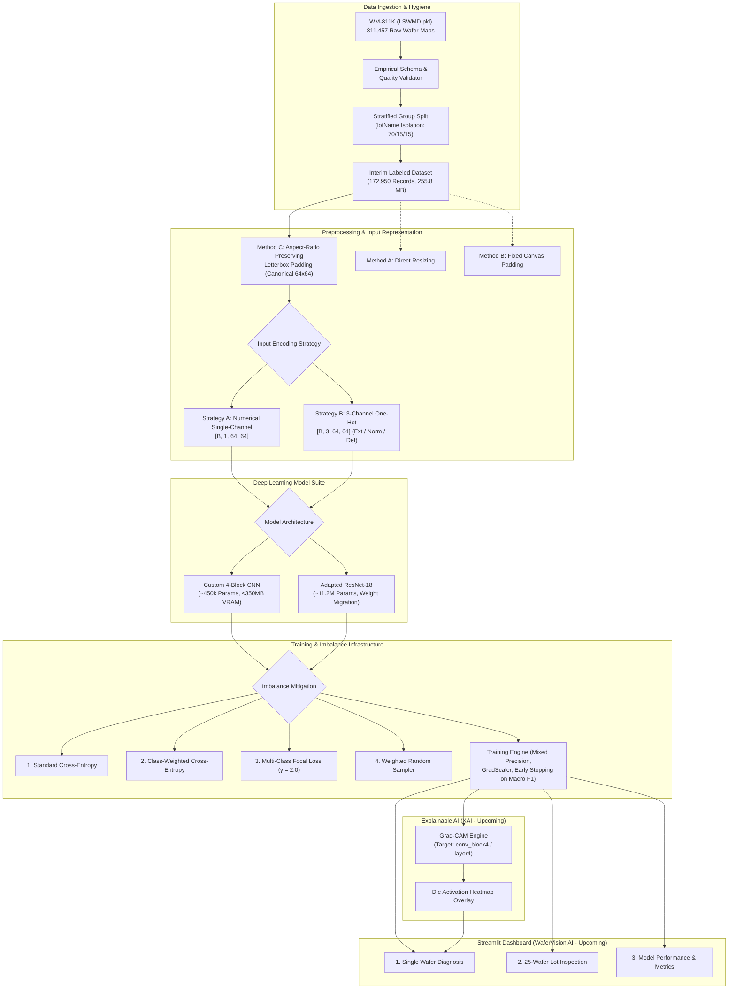

# Semiconductor Wafer Defect Detection & Classification

[](https://www.python.org/)
[](https://pytorch.org/)
[](https://developer.nvidia.com/cuda-toolkit)
[](https://github.com/astral-sh/ruff)
[](https://docs.pytest.org/)
[](LICENSE)

An end-to-end, production-grade deep learning system for automated spatial defect pattern classification on semiconductor wafer maps from the benchmark **WM-811K (LSWMD)** dataset. Designed with rigorous data hygiene to eliminate lot-level data leakage, domain-specific preprocessing, multi-class Focal Loss for severe class imbalance, Explainable AI (Grad-CAM), and an interactive Streamlit engineering dashboard.

---

## 📌 Executive Summary & Domain Context

In semiconductor device fabrication, silicon wafers undergo hundreds of chemical, photolithographic, and mechanical process steps (e.g., chemical mechanical planarization [CMP], plasma etching, ion implantation, thin-film deposition). Equipment drift, particulate contamination, thermal gradients, and mechanical stress manifest as distinctive spatial defect clusters across wafer die arrays.

Automated identification of spatial defect signatures is critical for root-cause yield learning. This project implements high-throughput, leak-free deep learning pipelines to categorize wafer defects into **9 canonical classes**:

| ID | Defect Class | Physical Fab Mechanism | Geometric Morphology | WM-811K Labeled Count | Percentage |
|:--:|:-------------|:-----------------------|:---------------------|----------------------:|-----------:|
| 0  | **none** | Normal production run (acceptable yield) | Random isolated die failures or zero failures | 147,431 | 85.24% |
| 1  | **Center** | CMP slurry over-polishing, center gas nozzle variations | Concentrated circular cluster at wafer center | 4,294 | 2.48% |
| 2  | **Donut** | Thermal anneal gradient, radial slurry pooling | Toroidal ring cluster surrounding normal center dies | 555 | 0.32% |
| 3  | **Edge-Loc** | Edge bead removal (EBR) error, clamp pin stress | Localized defect cluster along outer wafer boundary | 5,189 | 3.00% |
| 4  | **Edge-Ring** | Edge photoresist bevel drift, plasma chamber sheath edge | Complete or semi-continuous ring around wafer perimeter | 9,680 | 5.60% |
| 5  | **Loc** | Localized droplet/particulate splatter, chuck pin mark | Dense off-center cluster of defective dies | 3,593 | 2.08% |
| 6  | **Random** | Airborne particulates, incoming substrate defects | Uniformly scattered point defects across the wafer | 866 | 0.50% |
| 7  | **Scratch** | Robot end-effector handling slippage, CMP pad grit | Linear, curved, or jagged streak across multiple dies | 1,193 | 0.69% |
| 8  | **Near-full** | Massive process failure (gas starvation, gross contamination) | Extensive defective dies covering nearly entire wafer | 149 | 0.09% |

---

## 🏛️ System Architecture



---

## 🔬 Key Engineering Innovations

### 1. Zero Lot-Level Data Leakage (`StratifiedGroupKFold`)
* **Physical Fab Context:** Semiconductor wafers are processed inside physical cassettes called lots (`lotName`), each holding up to 25 wafers. Equipment drifts, etch chamber states, and chuck thermal variations are strongly correlated within a lot. Splitting individual wafers randomly leaks manufacturing lot signatures between train and test sets, yielding artificially inflated metrics that fail on new fabrication runs.
* **Our Implementation:** We enforce strict group isolation using 7-fold `StratifiedGroupKFold`:
  $$\text{Lots}_{\text{train}} \cap \text{Lots}_{\text{val}} = \emptyset, \quad \text{Lots}_{\text{train}} \cap \text{Lots}_{\text{test}} = \emptyset, \quad \text{Lots}_{\text{val}} \cap \text{Lots}_{\text{test}} = \emptyset$$
  Simultaneously, defect class frequencies are stratified so that even the rarest defects (`Near-full`: 149 samples, `Donut`: 555 samples) maintain balanced representation across all three partitions ($71.43\%$ Train, $14.28\%$ Val, $14.28\%$ Test).
* **Benchmark Split Preserved:** The original author-provided split (`Training`: 54,355, `Test`: 118,595) is separately preserved in [`data/interim/split_indices.json`](file:///data/interim/split_indices.json) as a reproducible comparative benchmark.

### 2. Dual Input Encoding Strategies
Implemented in [`src/data/transforms.py`](file:///src/data/transforms.py):
* **Strategy A — Numerical Single-Channel (`[B, 1, 64, 64]`):** Direct float representation containing discrete die values $\{0.0: \text{exterior}, 1.0: \text{normal}, 2.0: \text{defective}\}$. Compact memory footprint, ideal for fast convolution.
* **Strategy B — Three-Channel One-Hot (`[B, 3, 64, 64]`):** Discrete one-hot channel projection where:
  * **Channel 0:** Exterior space and canvas padding margin ($\text{die} == 0$)
  * **Channel 1:** Normal functional die ($\text{die} == 1$)
  * **Channel 2:** Defective die ($\text{die} == 2$)
  * *Padding Boundary Guarantee:* Canvas padding introduced during Method B or Method C letterboxing uses value $0$, which is correctly projected into Channel 0 (exterior space), preventing artificial boundary defects from corrupting model activations.

### 3. Dual Deep Learning Model Suite
Implemented in [`src/models/`](file:///src/models/):

#### Model A: Custom 4-Block CNN (`CustomWaferCNN`)
* **Target:** Lightweight, high-throughput baseline tailored for 4 GB VRAM GPU hardware.
* **Architecture:**
  * **Block 1:** `Conv2d(in_ch, 32, k=3, p=1)` $\to$ `BatchNorm2d(32)` $\to$ `ReLU()` $\to$ `MaxPool2d(2, 2)` $\implies [32, 32, 32]$
  * **Block 2:** `Conv2d(32, 64, k=3, p=1)` $\to$ `BatchNorm2d(64)` $\to$ `ReLU()` $\to$ `MaxPool2d(2, 2)` $\implies [64, 16, 16]$
  * **Block 3:** `Conv2d(64, 128, k=3, p=1)` $\to$ `BatchNorm2d(128)` $\to$ `ReLU()` $\to$ `MaxPool2d(2, 2)` $\implies [128, 8, 8]$
  * **Block 4:** `Conv2d(128, 256, k=3, p=1)` $\to$ `BatchNorm2d(256)` $\to$ `ReLU()` $\to$ `MaxPool2d(2, 2)` $\implies [256, 4, 4]$
  * **Adaptive Pooling:** `AdaptiveAvgPool2d((2, 2))` $\implies 1,024$ flattened features.
  * **Classifier Head:** `Dropout(0.30)` $\to$ `Linear(1024, 128)` $\to$ `ReLU()` $\to$ `Dropout(0.20)` $\to$ `Linear(128, 9)`.
* **Weights:** Kaiming normal initialization on all convolutions and linear layers.
* **Complexity:** ~450,000 parameters; $< 350\text{ MB}$ VRAM at batch size 64 with mixed precision.

#### Model B: Adapted ResNet-18 (`AdaptedResNet18`)
* **Target:** Deep residual network leveraging pre-trained ImageNet spatial representations.
* **Input Layer Adaptation & Weight Migration:** Single-channel inputs migrate ImageNet filters by computing the channel-wise average:
  $$W_{\text{new}} = \frac{1}{3} \sum_{c=1}^3 W_{\text{pretrained}}[:, c:c+1, :, :]$$
  preserving low-level edge, circle, and texture detectors without retraining from scratch.
* **Classification Head:** `Dropout(0.40)` $\to$ `Linear(512, 9)`.
* **Transfer Learning Support:** Includes `freeze_backbone()`, `unfreeze_backbone()`, and differential learning rate parameter grouping (`get_parameter_groups`).
* **Complexity:** ~11.2 million parameters; $\sim 1.1\text{ GB}$ VRAM at batch size 64 with mixed precision.

### 4. Controlled Imbalance Mitigation Experiments
Configured in [`configs/experiments.yaml`](file:///configs/experiments.yaml) to evaluate each technique independently against identical baseline conditions:
1. **Experiment 1 (Baseline Control):** Standard Cross-Entropy with uniform random shuffling.
2. **Experiment 2 (Loss Re-weighting):** Inverse-frequency Class-Weighted Cross-Entropy ($w_c = \frac{N}{K \cdot N_c}$).
3. **Experiment 3 (Hard-Example Mining):** Multi-Class Focal Loss:
   $$\text{FL}(p_t) = -(1 - p_t)^\gamma \log(p_t) \quad (\gamma = 2.0)$$
4. **Experiment 4 (Batch Balancing):** Weighted Random Sampler ($P \propto \frac{1}{N_c}$) with standard Cross-Entropy.

### 5. Production Training Engine
Implemented in [`src/training/`](file:///src/training/):
* **Automatic Mixed Precision (AMP):** Hardware-accelerated FP16/BF16 autocasting via `torch.amp.autocast('cuda')` with `GradScaler` to double throughput and halve activation VRAM.
* **Gradient Management:** Unscaling and gradient norm clipping (`max_norm = 1.0`) to stabilize backpropagation through deep blocks.
* **Early Stopping:** Monitors **Validation Macro F1** (`mode='max'`, `patience=7`), saving the optimal model checkpoint to `models/checkpoints/best_model.pt`.
* **Hardware VRAM Monitoring:** Tracks real-time peak allocated GPU VRAM (`torch.cuda.max_memory_allocated()`) per epoch.
* **Multi-Class Evaluation:** Tracks global accuracy, macro precision/recall/F1, per-class F1 across all 9 classes, and normalized confusion matrices.

---

## 📁 Repository Directory Structure

```text
Semiconductor-wafer-defect-detection/
├── .github/
│   └── workflows/
│       ├── lint.yaml                     # Ruff linting and formatting CI workflow
│       └── tests.yaml                    # Automated Pytest suite CI workflow
├── configs/                              # Centralized YAML configuration files
│   ├── data_config.yaml                  # Raw path, preprocessing method (A/B/C), group split keys
│   ├── experiments.yaml                  # 4 isolated class-imbalance experiment configurations
│   ├── model_config.yaml                 # CNN baseline & ResNet-18 architectures, hyperparameters
│   ├── train_config.yaml                 # Optimizer (AdamW), LR scheduler, loss (WCE vs. Focal), AMP
│   └── app_config.yaml                   # Streamlit layout and Grad-CAM layer targets
├── data/                                 # Local storage (STRICTLY gitignored)
│   ├── raw/                              # Untouched WM-811K (LSWMD.pkl)
│   ├── interim/                          # Optimized labeled dataset (255.8 MB), split indices, validation report
│   └── processed/                        # Canonical preprocessed wafer tensors & split artifacts
├── models/                               # Serialized weights (STRICTLY gitignored)
│   ├── checkpoints/                      # Epoch-wise training checkpoints
│   └── production/                       # Validated best weights (.pt) with evaluation metadata
├── notebooks/                            # Experimental Prototyping
│   ├── 01_eda_and_empirical_validation.ipynb
│   ├── 02_preprocessing_ablation.ipynb
│   ├── 03_baseline_cnn_training.ipynb
│   └── 04_gradcam_inspection.ipynb
├── scripts/
│   └── audit_pipeline.py                 # Automated pipeline audit (exclusivity, lot leakage, class counts)
├── src/                                  # Core modular source code
│   ├── __init__.py
│   ├── data/                             # Data engineering module
│   │   ├── __init__.py
│   │   ├── dataset.py                    # PyTorch WM811kDataset supporting single/3-ch representations
│   │   ├── group_split.py                # StratifiedGroupKFold splitting engine (zero lot leakage)
│   │   ├── transforms.py                 # Single-channel & one-hot encodings, data augmentation
│   │   ├── preprocessor.py               # Preprocessing pipelines: Method A, Method B, Method C
│   │   └── validator.py                  # Dynamic dataset schema and empirical statistics validator
│   ├── models/                           # Model architectures
│   │   ├── __init__.py
│   │   ├── custom_cnn.py                 # Custom 4-block CNN baseline (~450k params)
│   │   └── resnet18.py                   # Adapted ResNet-18 with channel-mean weight migration (~11.2M params)
│   ├── training/                         # Training & optimization engine
│   │   ├── __init__.py
│   │   ├── engine.py                     # Mixed precision training & validation loops, WaferTrainer manager
│   │   ├── losses.py                     # Weighted Cross-Entropy & Multi-Class Focal Loss implementations
│   │   ├── metrics.py                    # Multi-class Accuracy, Macro F1, Per-Class F1, Confusion Matrix
│   │   ├── sampler.py                    # Class-balanced WeightedRandomSampler
│   │   ├── scheduler.py                  # CosineAnnealingLR with warmup and Plateau schedulers
│   │   └── early_stopping.py             # Metric-driven early stopping and checkpoint saver
│   ├── xai/                              # Explainable AI module (Phase 4)
│   ├── inference/                        # Core prediction engine (Phase 6)
│   └── utils/                            # Shared logging and configuration utilities
├── app/                                  # Streamlit Interactive Web Application (Phase 5)
├── tests/                                # Automated Test Suite (35 Unit Tests)
│   ├── __init__.py
│   ├── unit/
│   │   ├── test_dataset.py               # Dataset integrity, record counts, and PyTorch dataset
│   │   ├── test_group_split.py           # Zero lot leakage, synthetic leakage detection, split distribution
│   │   ├── test_models.py                # Model shapes (1ch/3ch), forward/backward passes, CPU/CUDA, reproducibility
│   │   ├── test_preprocessor.py          # Methods A, B, C; integer preservation; oversized map handling
│   │   ├── test_training_pipeline.py     # Loss functions, weighted sampling, schedulers, checkpointing, metrics
│   │   └── test_transforms.py            # Single-channel, one-hot representation, padding space verification
│   ├── integration/
│   └── test_fixtures/
├── .env.example                          # Environment variable template
├── .gitignore                            # Strict exclusion rules (data, weights, archives, caches)
├── pyproject.toml                        # Project packaging and tool configuration
├── requirements.txt                      # Locked core runtime dependencies
├── requirements-dev.txt                  # Development and testing dependencies
└── README.md                             # Architectural overview, setup guide, and documentation
```

---

## 🚀 Getting Started

### Prerequisites
* **Operating System:** Windows 11 / Linux
* **Python Version:** 3.12 (`python --version` $\ge$ 3.12)
* **GPU (Optional but recommended):** NVIDIA RTX GPU (RTX 2050 / 3060 / 4060+) with CUDA 12.4+ support

### 1. Environment Setup
```bash
# Clone the repository
git clone https://github.com/darkPegsus/Semiconductor-wafer-defect-detection.git
cd Semiconductor-wafer-defect-detection

# Create a virtual environment using Python 3.12
py -3.12 -m venv .venv

# Activate the virtual environment
# Windows (PowerShell):
.venv\Scripts\Activate.ps1
# Linux / macOS:
source .venv/bin/activate

# Upgrade pip
python -m pip install --upgrade pip
```

### 2. Dependency Installation
```bash
# Install PyTorch with CUDA 12.4 acceleration (Windows/Linux)
pip install torch torchvision --index-url https://download.pytorch.org/whl/cu124

# Install core runtime and development dependencies
pip install -r requirements-dev.txt
```

### 3. Pipeline Audit & Verification
Run the data audit script to verify data integrity and zero lot leakage:
```bash
python scripts/audit_pipeline.py
```

---

## 🗺️ Development Roadmap

- [x] **Phase 1: Repository Scaffolding & Configuration Infrastructure**
  - Scaffold modular directory structure
  - Configure comprehensive Python `.gitignore` (strict data/weights exclusion)
  - Configure `pyproject.toml`, `requirements.txt`, and `requirements-dev.txt`
  - Author centralized YAML configuration files
- [x] **Phase 2: Data Engineering & Exploratory Data Analysis (EDA)**
  - Dataset download verification and schema validation on 811,457 wafer maps
  - Empirical distribution report generation (`dataset_validation_report.json`)
  - Filtered interim dataset generation (`labeled_wafers.pkl`, 172,950 records, 255.8 MB)
  - Implementation of Stratified Group Splitter with zero lot leakage (`lotName` isolation)
  - Preprocessing ablation benchmark (Methods A, B, and C)
- [x] **Phase 3: Deep Learning Modeling & Training Infrastructure**
  - Dual input representations: Single-channel numerical & 3-channel one-hot
  - Implementation of Custom 4-Block CNN Baseline (~450k parameters)
  - Implementation of Adapted ResNet-18 (~11.2M parameters) with channel-mean weight migration
  - Loss implementations: Standard Cross-Entropy, Class-Weighted Cross-Entropy, Multi-Class Focal Loss
  - Training engine with mixed precision (`torch.amp`), `GradScaler`, and early stopping on Macro F1
  - 4 isolated experiment configurations in `configs/experiments.yaml`
  - 35 automated unit tests passing across all components
- [ ] **Phase 4: Explainable AI (XAI) Integration**
  - Layer-targeted Grad-CAM hook integration (`conv_block4` and `layer4`)
  - Discrete die activation heatmap generator and overlay visualizer
- [ ] **Phase 5: Production Streamlit Dashboard (WaferVision AI)**
  - Single wafer upload and live diagnosis interface
  - 25-wafer lot cassette inspection and yield tracking
  - Live model performance metrics and interactive confusion matrix
  - WM-811K visual dataset explorer
- [ ] **Phase 6: Quality Assurance, Model Export & Final Documentation**
  - Production model export (`.pt`) and inference benchmark
  - Final documentation and deployment sign-off

---

## 🧪 Testing & Code Quality

Run linting and formatting checks via Ruff:
```bash
# Check code style and formatting
ruff check .
ruff format --check .

# Auto-format codebase
ruff format .
```

Run test suite via Pytest:
```bash
# Run all unit tests
pytest tests/unit -v

# Run tests with coverage report
pytest --cov=src --cov-report=term-missing
```

---

## 📜 License
This project is licensed under the MIT License - see the LICENSE file for details.
